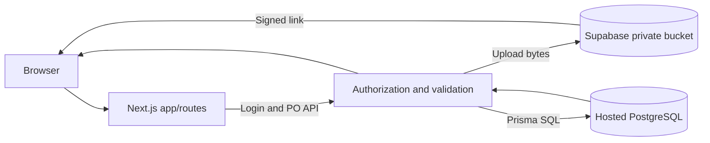

# PEP Brands FDE Technical Assignment

> Admission number and full name: _add before submission_

## Live app

- Live URL: _deployment is still required_
- Test password for all users: the `SEED_PASSWORD` value in `.env` (defaults to `ChangeMe!123`)

| Login | Role |
|---|---|
| creator1@pep.local | Creator |
| creator2@pep.local | Creator |
| approver1@pep.local | Approver |
| lead1@pep.local | Creator + Approver |

## Implemented scope and status

The local app implements login, server-enforced roles and PO transitions, action history, PDF upload, PostgreSQL persistence, Supabase Storage, and L1/L2 text-layer extraction. It is not yet publicly deployed, so Core B's public-URL requirement is outstanding.

`npm run db:seed` creates the four test users and seeds sample 1, the mismatch sample 2, and sample 4 as an unreadable draft for manual entry. Sample 3 is a resent copy of sample 1 and should be uploaded manually to demonstrate duplicate rejection.

## Run locally

1. Copy `.env.example` to `.env` and set Neon/Postgres, session and Supabase values.
2. Run `npm install`.
3. Run `npm run db:push`.
4. Run `npm run db:seed`.
5. Run `npm run dev`.

`/health` (also available at `/api/health`) returns 503 if PostgreSQL cannot be reached.

## Architecture

Upload journey: browser sends a multipart PDF to `/api/pos/upload`; the server authenticates and validates the role and size, extracts the text layer, checks for an existing PO number, uploads the original to object storage, creates the DRAFT and line items in PostgreSQL, and returns the PO id.

## Authorization choices

- **401:** no valid session on protected API routes.
- **403:** wrong role or creator attempting to decide their own PO.
- **404:** a creator trying to open another creator's PO. This avoids disclosing whether the PO exists.
- Permission checks live in `app/api` routes and are repeated at server level; the UI only exposes allowed actions.

The decision route uses a conditional `updateMany` on `status = SUBMITTED`, then appends history, preventing a second decision.

## PDF handling

Text-layer PDFs are parsed with `pdf-parse`. A document is considered unreadable when there is too little text or too low an alphanumeric ratio. The user gets an explicit manual-entry state and no extracted garbage. Dates accept ISO, dot/slash/hyphen day-month-year and `15 Nov 2026`. Rupee amounts are parsed into integer paise and all submit checks run server-side. OCR is not implemented; a production next step would render PDF pages to images and run a bounded OCR service, then run the same parser and server checks.

## Decisions

Next.js was selected for a single deployed web app and server APIs. PostgreSQL is managed by Prisma. Supabase private Storage supplies signed URLs. Passwords use bcrypt 12 rounds. Signed, HTTP-only JWT cookies provide sessions. Secrets stay in environment variables.

## Known limitations

Garbled text requires manual entry. Wrapped descriptions and unusual templates may need parser tuning. OCR is optional and not enabled. Public deployment, a public GitHub repository, the admission number/full name, and a complete unedited AI transcript still need to be supplied before submission. Database backups and monitoring also need provider setup.
