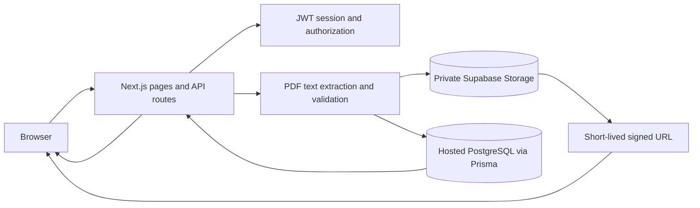

# PEP Brands FDE Technical Assignment

> Admission number: 23JE0659
> Full name: Nitin Kumar

## Submission links

- Live URL: `https://23je0659-mcaffeine-fde.vercel.app`
- GitHub repository: [webmasaster/23JE0659_mCaffeine_FDE](https://github.com/webmasaster/23JE0659_mCaffeine_FDE)
- AI chat share URL: _add the share link if the tool supports it_
- Test-user password: set `SEED_PASSWORD` in `.env`; do not commit or publish it.

## Test users

`npm run db:seed` creates or updates the four test accounts. Every seed run intentionally resets all four password hashes to the current `SEED_PASSWORD`.
All four accounts use that password; provide it to reviewers separately with the live URL, never in this public README or repository.

| Login | Role |
|---|---|
| `creator1@pep.local` | Creator |
| `creator2@pep.local` | Creator |
| `approver1@pep.local` | Approver |
| `lead1@pep.local` | Creator + Approver |

Use a unique `SEED_PASSWORD` of at least 12 characters with uppercase and lowercase letters, a number, and a symbol. It has no hardcoded default.

## Scope and sample PDFs

- **Core A:** bcrypt login, role checks, creator ownership, locked statuses, server-validated transitions, rejection remarks, and action history.
- **Core B:** PostgreSQL via Prisma, Supabase private object storage, signed PDF links, health endpoints, safe errors and environment configuration. The app is deployed on Vercel at the URL above.
- Login attempts are counted in PostgreSQL by a one-way hash of the normalized email; five failures in 15 minutes trigger a 15-minute lock. Deployments should also configure provider-level abuse protection.
- **Part 1 L1 and L2:** text-layer PDF header/total and line-item extraction, a correction form, paise-based arithmetic checks, and unreadable-PDF manual entry.
- OCR is not implemented; scanned or garbled PDFs are entered manually.

`npm run db:seed` seeds `sample_1_digital.pdf`, `sample_2_mismatch.pdf`, and `sample_4_garbled.pdf`, with sample records split across the two creators. Sample 3 is intentionally not seeded because it duplicates sample 1's PO number; upload it after seeding to demonstrate the duplicate error. Seeding requires a private `po-pdfs` bucket and fails clearly if an upload or database write fails.

## Run locally

1. Install Node.js 20 or newer.
2. Copy `.env.example` to `.env` and set all six variables listed below.
3. Install dependencies and generate Prisma Client:
   ```powershell
   npm ci
   npx prisma generate
   ```
4. Apply migrations (see **Database migrations** for existing databases):
   ```powershell
   npm run db:migrate
   ```
5. Seed accounts and sample POs:
   ```powershell
   npm run db:seed
   ```
6. Start the app:
   ```powershell
   npm run dev
   ```
7. Open `http://localhost:3000/login`.

## Environment and Supabase setup

Required variables (names only in `.env.example`):

- `DATABASE_URL`: Supabase PostgreSQL connection URL. Use a pooler URL appropriate for the host.
- `SESSION_SECRET`: random value of at least 32 characters.
- `SUPABASE_URL`: project URL.
- `SUPABASE_SERVICE_ROLE_KEY`: server-only Supabase secret/service-role key. Never prefix it with `NEXT_PUBLIC_`.
- `SUPABASE_BUCKET`: private bucket name; use `po-pdfs`.
- `SEED_PASSWORD`: unique seed password of at least 12 characters with uppercase and lowercase letters, a number, and a symbol.

Create a **private** Storage bucket named `po-pdfs`. The app uploads PDFs from the server and opens them through short-lived signed URLs after checking PO access. Never put `.env` or its values in GitHub or this README.

## Database migrations

The initial migration creates the relational schema. Two additive migrations add normalized PO numbers, extraction warnings and query indexes, then persistent login throttling. Existing records are preserved. Before the normalized unique index is added, the migration checks for PO numbers that collide after trimming and uppercasing; if any exist, it stops without committing changes so they can be reviewed.

For a **fresh database**, `npm run db:migrate` applies all migrations, including the persistent login-throttle table.

For the existing Supabase database previously initialized with `prisma db push`:

1. Take a database backup.
2. In Supabase SQL Editor, check for normalization collisions:
   ```sql
   SELECT UPPER(BTRIM("poNumber")) AS normalized_number, COUNT(*)
   FROM "PurchaseOrder"
   GROUP BY UPPER(BTRIM("poNumber"))
   HAVING COUNT(*) > 1;
   ```
3. If the query returns no rows and the existing schema is the original Prisma schema in this repository, mark the baseline migration as already applied:
   ```powershell
   npx prisma migrate resolve --applied 20261127000000_init
   ```
4. Apply the additive migrations:
   ```powershell
   npm run db:migrate
   ```

The login-throttle migration is additive and is applied after the normalized-PO migration. Do not mark it as applied unless the `LoginRateLimit` table already exists.

Do not run `prisma migrate reset` against data you want to keep. If the baseline schema differs, inspect and reconcile it before marking the baseline.

## Architecture and upload journey

The app uses Next.js 14 App Router, React, TypeScript, Prisma/PostgreSQL, private Supabase Storage, `bcryptjs`, `jose`, `pdf-parse`, and Zod. It is a small Next.js scaffold, not a third-party PO starter.



Upload journey: the browser posts a multipart PDF to `/api/pos/upload`. The server validates the session, creator role, PDF signature and size; extracts the text layer; checks for a duplicate; uploads the original to private Storage; and inserts the PO and line items in PostgreSQL. If the database insert fails after upload, the server attempts to remove the object. The response returns the PO page ID and extraction warnings.

## Authorization and workflow

- `lib/auth.ts` signs and verifies HS256 JWTs with issuer, audience, expiry, and schema-validated claims; the cookie is HTTP-only, SameSite=Lax, and Secure in production.
- Ownership/status rules are in `lib/po-access.ts`, applied in server-rendered pages and API routes.
- Approvers can review submitted POs and open approved/rejected records as read-only history; only submitted POs they did not create are actionable.
- **401:** missing/invalid session.
- **403:** authenticated user has the wrong role or attempts to decide their own PO.
- **404:** a creator opening another user's PO gets the same not-found response as an unknown PO, avoiding existence disclosure.
- **409:** duplicate PO number or invalid/concurrent state transition.
- The flow is `DRAFT → SUBMITTED → APPROVED` or `DRAFT → SUBMITTED → REJECTED → SUBMITTED`. Approval/rejection and their action-history entries share a transaction and use a conditional update from `SUBMITTED`.
- Submit/resubmit checks required values, positive whole quantities, line arithmetic and PO totals on the server. Money is stored as integer paise; the tolerance is ₹1 (100 paise).
- `/health` and `/api/health` return 200 only when PostgreSQL is reachable, otherwise 503.

## PDF extraction and checks

`lib/pdf.ts` normalizes text, evaluates whether the text layer is usable, reads PO headers, and recognizes rows beginning with SKU codes. For rows it parses the trailing quantity and currency-marked unit/line amounts, preserving numbers such as `200ml` in descriptions. Wrapped continuation lines are appended to the preceding item. Ambiguous rows are not guessed; extraction warnings are shown on the review page. `sample_4_garbled.pdf` is treated as unreadable and opens in a manual-entry state. OCR could be added by rendering pages to images, running a bounded OCR service, and sending the result through these same checks; OCR output must still be reviewed and verified.

Amounts are parsed strictly into paise and bounded to the PostgreSQL `INTEGER` range. Dates accept ISO and day-month-year numeric/month-name formats, and invalid calendar dates are rejected. The database enforces PO number uniqueness after uppercase/trim normalization.

## Tests

Run:

```powershell
npm test
npx prisma validate
npx tsc --noEmit
npm run build
```

The local suite covers money/date edge cases, the four provided PDFs, alternate labels, wrapped/numeric descriptions, Zod request validation, roles, ownership, lead self-approval prevention, allowed workflow transitions, and upload cleanup behavior when a database write fails. A database concurrency integration test is included but skipped by default. Run it only with `RUN_DB_INTEGRATION_TESTS=true` and a disposable `DATABASE_URL` whose database name includes `test`; it creates and deletes temporary users and a PO. Live storage-provider failure tests still require a separate disposable Supabase project.

## Deployment

The app is deployed to Vercel at the production URL listed above. Vercel detects Next.js and builds with `npm run build`.

Production configuration:

- Set `DATABASE_URL`, `SESSION_SECRET`, `SUPABASE_URL`, `SUPABASE_SERVICE_ROLE_KEY`, and `SUPABASE_BUCKET` in Vercel's **Production** environment. `SEED_PASSWORD` is needed only when running `npm run db:seed`; it is not required by the deployed app.
- Keep the Supabase Storage bucket private. Never expose `SUPABASE_SERVICE_ROLE_KEY` with a `NEXT_PUBLIC_` prefix.
- For the serverless runtime, use the Supabase transaction pooler connection string on port `6543` and add `pgbouncer=true` for Prisma. Run `npm run db:migrate` separately from a controlled environment using a direct or session-mode database connection; do not run migrations as part of every Vercel build.
- The current Supabase database is in Sydney. Set the Vercel Function region to `syd1` to keep server-side database requests near the database.
- Do not give Preview deployments the Production database and storage credentials. Use a separate staging project or disable Preview deployments.
- Vercel's default Function request body limit is 4.5 MB including multipart overhead, while this app currently accepts PDFs up to 5 MiB. Reduce the app and upload-page limit to 4 MiB, or configure Vercel's larger request-body option on a compatible plan and runtime.

The submission repository is `webmasaster/23JE0659_mCaffeine_FDE`. Update the local Git remote to this repository if it still points to the previous `webmasaster/FDE_Assignment` URL.

## AI transcript and remaining limitations

`ai-session/session.md` is explicitly a placeholder. Export the actual, unedited conversation from the AI tool into that file and add the real chat share link above if available. Do not invent missing conversation content. Inline autocomplete use must be stated separately by the author.

Known limitations: OCR is not included; unusual PDF templates may require parser tuning; workflow and storage integration tests need a disposable environment; final repository confirmation, reviewer credential delivery, and transcript export are still submission tasks. Login throttling is stored in PostgreSQL so it works across serverless instances; provider-level abuse protection is still recommended.
